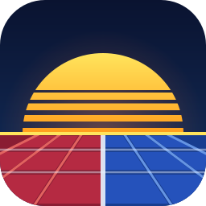

<p align="center"></p>

<h1 align="center">nettai</h1>

<p align="center">Rollback netplay for Mega Man Battle Network 4, 5 and 6.</p>

<p align="center">
  <a href="https://nettai.n1gp.net/#download"><b>Download</b></a> ·
  <a href="https://nettai.n1gp.net/">Website</a> ·
  <a href="https://github.com/nettaisen/nettai/releases">Releases</a>
</p>

nettai is a new program for playing Battle Network netbattles. Its battle engine is written in Rust, ported routine
by routine from the original games' code and checked frame by frame against them, so battles play the way they
did on the Game Boy Advance. Because the engine runs natively, it can rewind and replay frames cheaply, which
keeps online play smooth even across long distances.

- **Online:** make a room and send the code to a friend. Matches use rollback, so the game never stalls waiting
  on the network, and you choose your own input delay. A dropped connection reconnects and the battle picks up
  where it left off.
- **Builds:** pick a navi, put a folder together, and set up the NaviCust and patch cards, plus each game's own
  extras, like Crosses and Beast Out in Battle Network 6. You can also import a build from a save file. Every
  build plays at full power, with HP and memory maxed out.
- **Practice:** fight a dummy that stands still or moves around, or plug in a second controller.
- **Replays:** every match is saved. Watch it again from either side, or export it as a video (one side, both, or
  side by side).
- **Languages:** English, Japanese, Simplified Chinese and Traditional Chinese.

The supported games are Battle Network 4 (Red Sun and Blue Moon), 5 (Team ProtoMan and Team Colonel, including the
DS version's party battles) and 6 (Cybeast Gregar and Cybeast Falzar).

## Playing

1. Buy [Mega Man Battle Network Legacy Collection Vol. 2](https://store.steampowered.com/app/1798020/) on Steam.
   nettai reads its graphics and sound from your copy every time it starts. Nothing from the games is included
   with nettai or saved to disk.
2. [Download nettai](https://nettai.n1gp.net/#download) for Windows, macOS or Linux. It updates itself.
3. Start it. If it can't find the Legacy Collection (on macOS, for example), it asks you to choose the
   collection's folder. You can also drop the folder onto the window.

### Controls

| Button | Keyboard | Controller |
| --- | --- | --- |
| Move | Arrow keys | D-pad |
| A | Z | East button |
| B | X | South button |
| L / R | A / S | Shoulders |
| Start / Select | Enter / Backspace | Start / Back |
| Switch navi (party battle) | C / V | West / North button |

Esc opens the menu during a battle. Everything can be rebound in Settings.

## How it works

- **The engine** (`nettai-battle`) knows nothing about any particular game. A battle is deterministic: the
  players' inputs are its only input, and it can be snapshotted and restored at any frame. That is what rollback
  netplay needs.
- **The games' content** (chips, navis, rules, and how to find each asset in the ROMs) is written in
  [Luau](https://luau.org/) and lives in its own repositories: [exe4](https://github.com/nettaisen/exe4),
  [exe5](https://github.com/nettaisen/exe5), [exe6](https://github.com/nettaisen/exe6) and the shared
  [exelib](https://github.com/nettaisen/exelib). They are checked out here as git submodules under `content/`.
  Content is published separately from the app, which downloads it, and a replay always finds the content it was
  recorded with.
- **Graphics and sound** are decoded from the Legacy Collection's ROMs in memory as each game loads. Sound plays
  through a port of the GBA's M4A sound driver, so the music is the ROM's own song data.
- **Netplay** runs on [getgud](https://github.com/tangobattle/getgud) (rollback) and
  [rennet](https://github.com/tangobattle/rennet) (inputs) over WebRTC data channels
  ([str0m](https://github.com/algesten/str0m) on desktop, the browser's own on the web). Players meet through a
  small signaling server, a Cloudflare Worker in `signaling/`, or connect directly.
- **Verification** happens in a separate workspace: golden traces of real matches and thousands of recorded chip
  scenarios, compared frame by frame (and sound by sound) with the original games running in an emulator.

## Building from source

You need Rust (stable, edition 2024), CMake (for SDL), and the Legacy Collection.

```sh
git clone --recursive https://github.com/nettaisen/nettai.git
cd nettai
cargo run --release -p nettai
```

In an existing clone or a new worktree, run `git submodule update --init` to get the content. Run from the
repository, the app plays the checkout's `content/` and downloads nothing.

On Linux, also install the development packages for ALSA, fontconfig, udev, Wayland and xkbcommon (on
Debian/Ubuntu: `cmake pkg-config libasound2-dev libfontconfig1-dev libudev-dev libwayland-dev libxkbcommon-dev`).

### The ROMs

The app finds the Legacy Collection through Steam. The command line, the tests and development read
`$NETTAI_ROMS` first: either the collection's install folder, or a folder holding its twelve ROM files (any
names; each file's header says which ROM it is).

```sh
export NETTAI_ROMS=~/path/to/roms
cargo run --release -p nettai-content -- check exe6   # extract a game's assets and check them against its content
```

### Tests

```sh
cargo test --workspace                                 # the engine on its own test content; no ROMs needed
cargo run -p nettai-content-check                      # type-check and lint every content pack
cargo test -p nettai-netplay -p nettai-rtc -p nettai-frontend   # netplay over a simulated lossy network
```

### Command line

`nettai-tool` runs battles with no window: it renders frames, checks and exports replays, and audits content.
`--help` lists everything; [docs/tools.md](docs/tools.md) explains it.

```sh
cargo run --release -p nettai-tools -- --match match.toml --headless 1-120 --out frames/   # frames to PNG
cargo run --release -p nettai-tools -- --replay set.nettaireplay                          # does it reproduce?
cargo run --release -p nettai-tools -- --replay set.nettaireplay --mp4 set.mp4            # replay to video
```

### Local signaling server

```sh
cd signaling && npx wrangler dev                      # http://127.0.0.1:8787
NETTAI_SIGNAL=ws://127.0.0.1:8787 cargo run --release -p nettai
```

### In a browser

The app also runs in Chromium. `bash crates/nettai-web/build.sh` builds it and
`python3 crates/nettai-web/serve.py` serves it at http://localhost:8000/. It needs nightly Rust, wasm-bindgen-cli
and the WASI SDK; see [docs/app.md](docs/app.md) §6.

## Repository layout

| Path | What it is |
| --- | --- |
| `crates/nettai-battle` | The battle engine: simulation core and the content model it runs on |
| `crates/nettai-content-api`, `nettai-luau` | The API content scripts call, and the sandboxed Luau runtime |
| `crates/nettai-content`, `nettai-content-check` | Loading content into the engine; type-checking and publishing it |
| `crates/nettai-match` | Match files and builds, checked against a game's content |
| `crates/nettai-extract`, `nettai-assets` | Asset extraction from the ROMs, and the graphics in typed form |
| `crates/nettai-render`, `nettai-audio`, `m4a` | Drawing a battle into frames; sound through the M4A driver |
| `crates/nettai-frontend` | Plays battles for a host app: live, online or from a replay (no window) |
| `crates/nettai-netplay`, `nettai-rtc` | Rollback netplay, and its WebRTC transport |
| `crates/nettai-replay`, `nettai-video` | The replay format; replays exported as MP4 |
| `crates/nettai`, `nettai-ui` | The app (Slint), and its UI files |
| `crates/nettai-files`, `nettai-threads`, `nettai-dialogs`, `nettai-http`, `nettai-page`, `nettai-lifecycle`, `nettai-android`, `nettai-gamepad` | What the app asks of the system, the same on the desktop, in a browser and on a phone, a crate a concern |
| `crates/nettai-web` | The browser build |
| `crates/nettai-tools` | `nettai-tool`, the command line |
| `crates/nettai-training`, `training/` | A learned AI opponent (work in progress): the Rust side and the Python trainer |
| `crates/exe4-compat`, `exe5-compat`, `exe6-compat` | Each game's original IDs, save import and trace formats (the engine never depends on these) |
| `content/` | The game content repositories (submodules) |
| `signaling/` | The matchmaking server (Cloudflare Worker) |
| `packaging/` | Installers and release packages |
| `docs/` | Documentation |

## Documentation

- [docs/content.md](docs/content.md): editing content (in Zed), checking it, and publishing it.
- [docs/design](docs/design): how the engine and content are built, starting with the content model
  ([content-model-v2.md](docs/design/content-model-v2.md)), where Rust ends and Luau begins
  ([rust-and-luau.md](docs/design/rust-and-luau.md)), and [rollback.md](docs/design/rollback.md).
- [docs/engine](docs/engine): the original games' battle routines, specified from the disassembly.
- [docs/frontend.md](docs/frontend.md): the frontend library, and the match file format (§6).
- [docs/app.md](docs/app.md): the app, its screens and packaging; [design/app-ui.md](docs/design/app-ui.md) is its
  design.
- [docs/tools.md](docs/tools.md): the command line.

## License

nettai is licensed under the [Mozilla Public License 2.0](LICENSE). Bundled third-party files keep their own
licenses: the fonts are under the SIL Open Font License (each folder's `OFL.txt`), and
`crates/nettai-luau/wasm/Unwind-wasm.c` is LLVM's, under the Apache License 2.0 with LLVM Exceptions. The app's
About screen lists every package it is built from.

Mega Man Battle Network is a trademark of CAPCOM CO., LTD. nettai is a fan project and is not affiliated with,
funded by, or in any way associated with Capcom.
